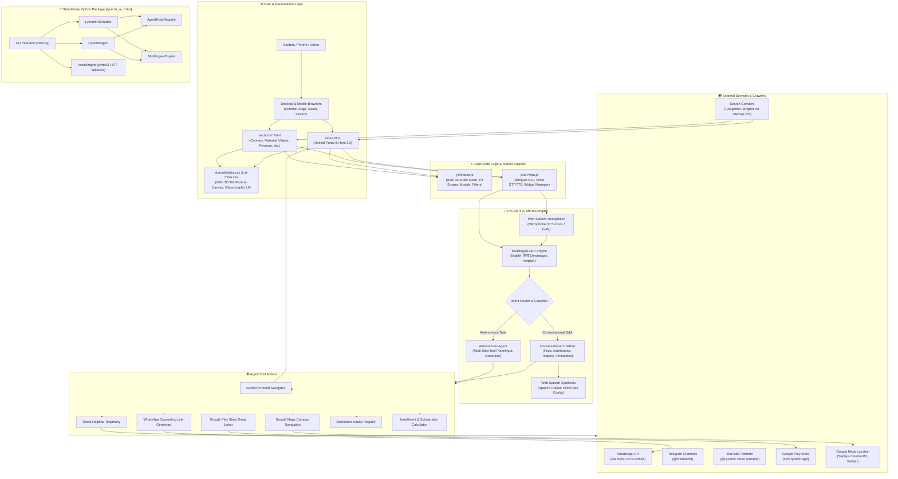
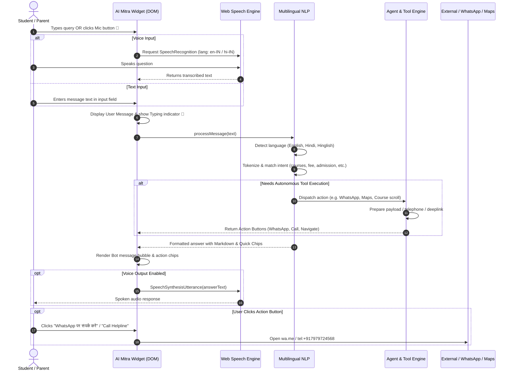
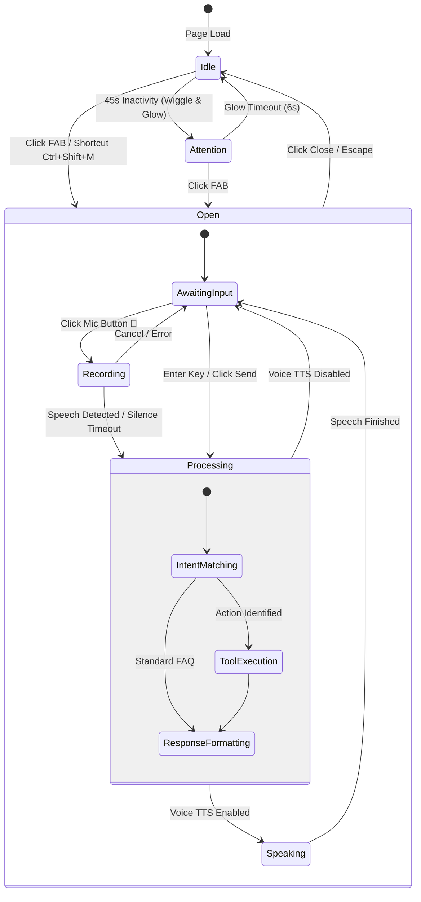
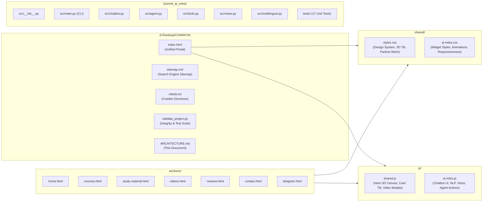

# 🏛️ Architecture & System Design — Chanakya Classes & LYCEMIT AI Mitra

> **English** • Comprehensive architecture diagrams, component interactions, and data flow specifications for the **Chanakya Classes & Lycemit Web Portal** and **LYCEMIT AI Mitra** intelligent system.
>
> **हिन्दी** • **चाणक्य क्लासेज और लाइसमिट वेब पोर्टल** तथा **LYCEMIT AI मित्र** इंटेलिजेंट सिस्टम के व्यापक आर्किटेक्चर आरेख, घटक इंटरैक्शन और डेटा प्रवाह विनिर्देश।

---

## 1. High-Level System Architecture

---

## 2. Voice & Text Interaction Sequence Diagram

---

## 3. AI Mitra State Machine Diagram

---

## 4. Component Directory & File Mapping

---

## 5. Security & Performance Layer

| Architectural Feature | Implementation | Defensive Protection |
|---|---|---|
| **XSS Prevention** | Full entity escaping (`&`, `<`, `>`, `"`, `'`) and DOM `textContent` bindings | Prevents malicious script or attribute breakout in chat dialogue |
| **Reverse Tabnabbing** | `rel="noopener noreferrer"` enforced on all `target="_blank"` anchors | Prevents opener window manipulation by untrusted external links |
| **Search Engine Directives** | `robots.txt` + `sitemap.xml` + Canonical links on every page | Eliminates duplicate content penalties and prevents crawler indexing loops |
| **Microphone & Speech Privacy** | Ephemeral voice recognition with explicit user click triggers only | No persistent audio recording or background listening |
| **Performance (60 FPS)** | GPU-accelerated CSS `transform-style: preserve-3d` & `IntersectionObserver` pause | Zero CPU usage when hero section or widget is off-screen |
| **Automated Verification** | `validate_project.py` checks 28 assets, 8 HTML files, SEO tags & Python unit tests | Continuous integrity enforcement |

